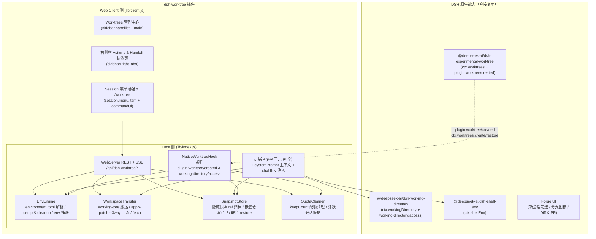

# `dsh-worktree` 实现方案（方案 A：DSH 原生 Worktree 增强插件）

> **设计前提**：DeepSeek Harness (`0.2.2-rc.5`) 已内置官方实验性 Forge 套件（`@deepseek-ai/dsh-experimental-worktree`、`@deepseek-ai/dsh-experimental-tool-worktree`、`@deepseek-ai/dsh-experimental-client-ui-forge`），提供了新会话勾选创建、`create_worktree` 工具、干净目录归档清理、外部删除恢复与 Diff/PR 视图。
>
> 本方案采用 **原生增强路线**：**完全复用 DSH 已有的创建入口、分支图标与 Diff/PR 面板，不重复造轮子**，专注对标 ChatGPT / Codex Worktree 补齐 DSH 官方尚未提供的 6 大核心能力，并做到 `.codex/environments/environment.toml` 零成本兼容。

---

## 一、职责边界：DSH 原生 vs `dsh-worktree`

| 能力维度 | DSH 原生（Forge 套件）负责 | `dsh-worktree` 增强补齐 |
| --- | --- | --- |
| 新会话勾选 & 选基准分支 | ✅ `WorktreeToggle` + 创建进度卡片 | 复用原生入口，不重复加勾选框 |
| 模型基础建树 | ✅ `create_worktree({ name?, from? })` | 复用原生工具；补充高级工具（带改动搬运、回流、快照归档/恢复、Actions） |
| 侧边栏分支图标 & Diff/PR 审查 | ✅ `dsh-experimental-client-ui-forge` | 完全复用，避免 UI 冲突 |
| **本地环境初始化与清理** | ❌ 不装依赖、不拷 `.env`、无脚本钩子 | ✅ 解析 `.dsh` / `.codex` 的 `environment.toml`，自动跑 `setup` / `cleanup` 并捕获环境变量 |
| **快捷 Actions** | ❌ 无 | ✅ 读取 `[[actions]]`，在面板与右侧栏一键执行（Dev / Test / Build / Debug） |
| **带入未提交改动 & 双向 Handoff** | ❌ 仅从本地 commit 干净签出；无回流主目录 | ✅ 支持把当前未提交/未跟踪改动带入新 worktree；支持 `apply-patch --3way` 一键回流主目录 |
| **建树前自动 `git fetch`** | ❌ 仅限本地已有提交 | ✅ `upstreamRefreshMode: best-effort` 刷新远端最新提交 |
| **未提交改动快照归档 & 无损恢复** | ❌ 仅清理干净目录；外部删除无法恢复未提交改动 | ✅ 归档前写入隐藏 Git 快照 `refs/dsh-worktree/snapshots/<id>`，释放磁盘且可无损还原 |
| **跨项目集中管理 & 配额策略** | ❌ 无全局管理页、无 `keepCount`、无单仓策略 | ✅ 统一 Worktrees 管理页 + `keepCount`（默认 15）配额清理 + 单仓策略（`ask/always/never/dirty`） |

---

## 二、总体架构与原生挂接点

`dsh-worktree` 作为一个独立 DSH Bundle，直接挂载在 DSH 原生服务之上（软依赖 `worktrees`，即使未启用 Forge 套件也能以独立模式兜底运行）：



### 关键原生挂接机制（均已对照 DSH `0.2.2-rc.5` 源码核实）

1. **自动感知原生 Worktree 创建**：
   - DSH 原生 `ctx.worktrees.create(...)` 在切入新目录后会向 Session 日志写入 `plugin:worktree/created` 记录（含 `{ path, branch, baseCommit, repositoryRoot }`）并更新 `worktree` 投影。
   - `dsh-worktree` 监听该创建记录与 `working-directory/change`，自动将新 worktree 纳入索引，并在 `autoRunSetup` 开启时自动触发项目 `environment.toml` 的 `[setup]` 脚本。
   - 通过 `working-directory/access`（waterfall）或会话活动钩子 `workspace/session-activity` 协调 setup 执行窗口，避免在依赖未装完前误触发归档。
2. **原地 Handoff（同会话无缝切入）**：
   - DSH 原生 `ctx.workingDirectory.set(agent, path)` 支持**在同一个 Session 内原地切换工作目录**（Session header 保留原项目根目录）。
   - 因此「本地未提交改动转入 Worktree（Handoff）」既支持**在当前会话原地切入**（先暂存打包主目录改动 → 调 `ctx.worktrees.create` 建树并切入 → 还原改动到新 worktree），也支持**新建独立会话切入**。
3. **原生 Shell 环境变量注入（`ctx.shellEnv`）**：
   - 通过 `@deepseek-ai/dsh-shell-env` 的 `ctx.shellEnv.register(...)`，为处于 worktree 内的每一次模型 Shell 命令自动注入受管变量：
     - `DSH_WORKTREE_SOURCE_ROOT`（源仓库主目录）
     - `DSH_WORKTREE_PATH`（当前 worktree 路径）
     - `DSH_WORKTREE_BRANCH`（当前分支）
     - `DSH_WORKTREE_ENV_FILE`（`setup` 捕获到的非 `DSH_*` 自定义环境变量文件路径，供脚本按需加载）
   - 在执行 `actions` 和 `cleanup` 时，直接把 `capturedEnv` 自动合入子进程环境。

---

## 三、配置体系设计

### 3.1 应用级插件配置（Host `Config`，不与原生字段重复）

> 原生 `@deepseek-ai/dsh-experimental-worktree` 已管理 `directory`（`.agents/worktrees`）、`namePrefix`（`dsh-`）和 `retainOnArchive`。`dsh-worktree` 仅声明**增强配置项**：

| 配置字段 | 对标 ChatGPT Key | 类型 / 枚举 | 默认值 | 说明 |
| --- | --- | --- | --- | --- |
| `autoRunSetup` | Local Environments setup | `boolean` | `true` | 检测到新 worktree 创建时自动执行 `environment.toml` 的 `[setup]` |
| `autoRunCleanup` | Local Environments cleanup | `boolean` | `true` | 归档或删除 worktree 前自动执行 `[cleanup]` |
| `setupTimeoutMs` | — | `integer >= 1000` | `300000` | `setup` / `cleanup` 脚本超时时间（默认 5 分钟） |
| `upstreamRefreshMode` | `worktree-upstream-refresh-mode` | `"never" \| "best-effort"` | `"never"` | 通过本插件创建/Handoff 前是否先 `git fetch` 远端最新提交 |
| `defaultCreationPreference` | `worktree-creation-preference` | `"ask" \| "always" \| "never" \| "dirty"` | `"ask"` | 默认编辑隔离策略（`dirty`：仅主目录有未提交改动时提醒/建议进 worktree） |
| `repositoryPreferences` | `worktree-repository-preferences` | `Array<{ commonDir, root, preference }>` | `[]` | 按仓库 `git-common-dir` 覆盖单仓策略 |
| `snapshotOnArchive` | Snapshot Archive | `boolean` | `true` | 归档/配额清理含未提交改动的 worktree 前，写入隐藏快照 ref |
| `autoCleanupEnabled` | `worktree-auto-cleanup-enabled` | `boolean` | `true` | 是否启用按数量的旧 worktree 自动清理 |
| `keepCount` | `worktree-keep-count` | `integer >= 1` | `15` | 自动清理时最多保留的最近 worktree 数量 |
| `confirmBeforeDelete` | `worktree-confirm-before-delete` | `boolean` | `true` | 管理页手动删除前是否弹窗二次确认 |

### 3.2 项目级本地环境配置（`environment.toml` — 100% 兼容 ChatGPT / Codex）

#### 配置文件查找优先级
1. 仓库局部 git config `dsh.localEnvironmentConfigPath`（值为 `"__none__"` 时禁用）
2. 仓库局部 git config `codex.localEnvironmentConfigPath`（兼容 Codex 配置）
3. `<gitRoot>/.dsh/environments/environment.toml`
4. `<gitRoot>/.codex/environments/environment.toml`

#### TOML Schema
```toml
version = 1
name = "My Project"

[setup]
script = """
# 同时注入 DSH_SOURCE_TREE_PATH / CODEX_SOURCE_TREE_PATH
# 与 DSH_WORKTREE_PATH / CODEX_WORKTREE_PATH
cp "$DSH_SOURCE_TREE_PATH/.env.local" "$DSH_WORKTREE_PATH/.env.local" 2>/dev/null || true
pnpm install --frozen-lockfile
"""

[setup.darwin]
script = "..."

[setup.linux]
script = "..."

[setup.win32]
script = "..."

[cleanup]
script = """
docker compose down --remove-orphans || true
"""

[[actions]]
name = "Dev Server"
icon = "run"          # "tool" | "run" | "debug" | "test" | null
command = "pnpm dev"
platform = "darwin"   # 可选："darwin" | "linux" | "win32"

[[actions]]
name = "Test"
icon = "test"
command = "pnpm test"
```

---

## 四、6 大增强模块详细设计

### 4.1 环境编排与变量捕获（`src/core/env-config.ts` & `src/core/env-runner.ts`）
- **跨平台脚本选择**：优先取当前 OS（`darwin` / `linux` / `win32`）下非空的 `script`，否则回退顶层 `script`。
- **凭据清洗与内置变量注入**：所有脚本经 `ctx.subprocess.spawn` 启动，基于 `scrubbedParentEnv()` 过滤 `DEEPSEEK_API_KEY` 等宿主凭据，显式注入：
  - `DSH_SOURCE_TREE_PATH` + `CODEX_SOURCE_TREE_PATH`
  - `DSH_WORKTREE_PATH` + `CODEX_WORKTREE_PATH`
  - `DSH_WORKTREE_BRANCH`
- **环境变量差集捕获**：POSIX 通过 wrapper 在 `setup` 前后分别输出 `env -0` 到临时文件，计算新增/修改项（剔除 `PWD`/`OLDPWD`/`SHLVL`/`_` 与敏感凭据），写入元数据与 `<worktreeGitDir>/dsh-worktree.env`。
- **流式日志与容错**：实时推送 stdout/stderr 给前端 SSE；若 `setup` 失败，保留 worktree 并记录 `setupError`，提供手动「重试 Setup」入口，不无限自动重试。

### 4.2 双向 Handoff 与工作区搬运（`src/core/transfer.ts`）
- **Local → Worktree（带未提交改动转入）**：
  1. 若 `upstreamRefreshMode === 'best-effort'`，先执行可取消的 `git fetch`。
  2. 将主目录的 staged diff、unstaged diff 和非 ignored untracked 文件打包至临时区（不修改主目录本身）。
  3. 调用原生 `ctx.worktrees.create(agent, { from, name })`（无原生服务时降级走内置 `git worktree add`）创建隔离目录并切入。
  4. 将打包的未提交改动无损应用到新 worktree，并自动触发 `setup`。
  5. 可选参数 `cleanSource: false`（默认保留主目录改动，由用户确认后再清理）。
- **Worktree → Local（`apply-patch` 一键回流主目录）**：
  1. 计算 worktree 相对 `baseCommit`（或仅未提交改动，可选模式 `branch` / `uncommitted`）的 patch。
  2. 先执行 `git apply --check --3way` 预检，返回变更文件数与潜在冲突列表。
  3. 确认后应用到 `sourceRoot`，冲突时明确报告冲突文件而不静默覆盖。

### 4.3 无损快照归档与联合恢复（`src/core/snapshot.ts`）
- **安全守卫**：归档前检查 worktree 是否存在已初始化 submodule 或嵌套 `.git` 仓库；若存在，拒绝自动销毁目录并提示保留 checkout，防止丢代码。
- **隐藏快照写入**：使用临时 `GIT_INDEX_FILE` 执行 `git add -A` → `git write-tree` → `git commit-tree <tree> -p <HEAD>` → `git update-ref refs/dsh-worktree/snapshots/<id> <commit>`。
- **安全清理**：依次执行 `[cleanup]` 脚本 → `git worktree remove --force` + `git worktree prune`，在元数据中标记 `status = 'archived'` 并记录 `snapshotRef`。
- **联合恢复（叠加原生 `ctx.worktrees.restore`）**：
  1. 先调用原生 `ctx.worktrees.restore(agent, record)`（或内置 git 恢复）还原目录与分支；
  2. 若存在 `snapshotRef`，将快照中的 tree 状态还原回工作区未提交文件，实现**连同未提交代码一起无损恢复**。

### 4.4 配额自动清理（`src/core/cleaner.ts`）
- 扫描托管池及原生 `.agents/worktrees` 下由 DSH 管理的 worktree 记录。
- 当 `autoCleanupEnabled === true` 且未归档数量超过 `keepCount`（默认 15）时，按 `lastAccessedAt` 从旧到新清理：
  - 跳过仍在运行或未归档的活跃 Session；
  - 跳过含嵌套仓库/子模块的目录；
  - 干净目录直接执行 `cleanup` + 移除；有未提交改动且 `snapshotOnArchive === true` 时先打隐藏快照再移除。
- 注册 `workspace/session-activity` 与 `workspace/session-stop` 监听器：setup/action 运行期间防止会话误归档，强制归档时优雅终止子进程。

### 4.5 扩展 Agent 工具与动态上下文（`src/tools.ts` & `src/prompt.ts`）

> 复用原生 `create_worktree`，仅补充 6 个原生缺失的高阶工具（均使用 `@deepseek-ai/dsh-tools` `defineTool`）：

| 工具名 | 作用 |
| --- | --- |
| `worktree_handoff` | 将当前会话（可选携带未提交改动 & 先 `git fetch`）转入新 worktree 并触发 `setup` |
| `worktree_setup` | 读取当前仓库 `environment.toml`，查看环境状态或手动触发/重跑 `setup` |
| `worktree_actions` | 列出或执行 `environment.toml` 中定义的快捷动作（`mode: "list" \| "run"`） |
| `worktree_apply_patch` | 预检（`dryRun`）或将当前 worktree 改动通过三方合并应用回源主工作区 |
| `worktree_archive` | 执行 `cleanup`、为未提交改动保存隐藏快照并释放 worktree 目录 |
| `worktree_restore` | 从隐藏快照恢复已归档 worktree（含未提交文件） |

- **系统上下文注入（`ctx.systemPrompt.context`，`order: 105`）**：
  - 处于托管 worktree 时，告知模型源仓库路径、当前环境配置、可用 `actions` 列表及 setup 状态（若失败给出错误摘要）。
  - 处于普通本地仓库且命中 `defaultCreationPreference` / `repositoryPreferences` 的 `always` 或 `dirty` 策略时，提醒模型先征求确认或调用 `worktree_handoff` / `create_worktree` 进入隔离目录再修改文件。

### 4.6 WebServer API & Web Client UI（`src/server.ts` & `src/client/`）

- **HTTP + SSE 路由（`/api/dsh-worktree/*`）**：
  - `GET /worktrees`：聚合扫描所有已登记 workspace 下的原生与增强 worktree（分支、改动数、磁盘占用、环境状态、快照状态、关联 Session）。
  - `POST /handoff`、`POST /worktrees/:id/setup`、`POST /worktrees/:id/actions/:name/run`、`POST /worktrees/:id/apply-patch`、`POST /worktrees/:id/archive`、`POST /worktrees/:id/restore`、`DELETE /worktrees/:id`。
  - `GET /operations/:id/stream`：SSE 实时推送 `setup` / `cleanup` / `action` 日志流与取消接口。
  - `GET / PUT /environments`：读取/保存 `.dsh/environments/environment.toml`（或 `.codex/environments/environment.toml`）。
  - `GET / PUT /repo-preferences`：读写按仓库策略。

- **Client UI 挂载（严格复用原生 Slot，不与 Forge 冲突）**：
  1. **主管理面板（`sidebar.panellist` + `main`，`key: 'dsh-worktree'`）**：
     - **Worktrees Tab**：跨项目集中查看全部 worktree（就绪 / 已快照归档），一键跳转关联 Session、重跑 Setup、应用改动回主目录、归档、恢复、删除，以及配置单仓策略。
     - **Environments Tab**：可视化的 `environment.toml` 编辑器（Setup / Cleanup 分平台脚本 Tab + Actions 列表管理 + 一键试跑）。
  2. **右侧栏标签页（`sidebarRightTabs`）**：
     - 当前会话处于 worktree 时，提供轻量面板展示环境状态（setup 日志/重跑）、一键 `Actions` 按钮列表与「应用改动到主目录 / 快照归档」快捷操作。
  3. **会话菜单 & `/worktree` 命令**：
     - `sidebar.workspaces.session.menu.item`（`order: 350`）：本地会话展示「带改动转入 Worktree」，Worktree 会话展示「应用改动到主目录」「快照归档 Worktree」。
     - `commandUi` 注册 `/worktree`：快捷触发 Handoff 或打开右侧 Worktree Actions 面板。

---

## 五、代码目录规划

```text
dsh-worktree/
├── package.json
├── cordis.patch.yml
├── locale/
│   ├── zh.json
│   └── en.json
├── src/
│   ├── index.ts                # Host 入口、Config Schema、原生 hook 与服务挂载
│   ├── types.ts                # 领域类型（WorktreeMeta / EnvironmentConfig / OperationEvent）
│   ├── core/
│   │   ├── env-config.ts       # environment.toml 发现、解析、校验与写回（兼容 .codex）
│   │   ├── env-runner.ts       # 跨平台 setup/cleanup/actions 执行、SSE 日志与 env 差集捕获
│   │   ├── transfer.ts         # working-tree 打包搬运、fetch 刷新、apply-patch --3way 回流
│   │   ├── snapshot.ts         # 隐藏快照 ref 归档、嵌套仓库守卫、联合恢复
│   │   ├── store.ts            # 插件 state.json + <gitDir>/dsh-worktree.json 持久化与仓库锁
│   │   ├── cleaner.ts          # keepCount 配额自动清理 + 会话活动联动
│   │   └── service.ts          # WorktreeEnhanceService 编排层
│   ├── tools.ts                # 6 个扩展 defineTool 工具
│   ├── prompt.ts               # systemPrompt 上下文 + shellEnv 变量注入
│   ├── server.ts               # ctx.webServer REST + SSE 路由
│   └── client/
│       ├── index.tsx           # Web Client 入口（Slots / commandUi / sidebarRightTabs）
│       ├── api.ts              # HTTP + SSE 客户端
│       ├── locales.ts          # 双语字典与 LocaleNamespaceMap
│       ├── Panel.tsx           # 全局 Worktrees 管理页 & Environments 编辑器
│       ├── RightPane.tsx       # 右侧栏快捷 Actions 与回流面板
│       └── SessionMenu.tsx     # Session ... 菜单增强项
└── tests/
    ├── env-config.spec.ts      # .dsh / .codex environment.toml 发现与分平台覆盖测试
    ├── env-runner.spec.ts      # setup 执行与 env 差集捕获测试
    ├── transfer.spec.ts        # working-tree 搬运与 apply-patch --3way 测试
    ├── snapshot.spec.ts        # 快照归档、嵌套仓库拒绝、无损恢复测试
    ├── cleaner.spec.ts         # keepCount 清理与活跃会话跳过测试
    └── tools.spec.ts           # 扩展工具契约测试
```

---

## 六、分阶段实施路线图

### Phase 1：本地环境引擎（最高频痛点，立即可用）
- [ ] 引入 `smol-toml` 与 `proper-lockfile`。
- [ ] 实现 `core/env-config.ts` 与 `core/env-runner.ts`：完整兼容 `.dsh` / `.codex` 的 `environment.toml`、分平台 `setup`/`cleanup`/`actions`、环境变量差集捕获与实时日志。
- [ ] 对接 DSH 原生 `plugin:worktree/created` 监听与 `ctx.shellEnv` 注入：在用户用原生勾选框或 `create_worktree` 建好 worktree 后自动跑 `setup`。
- [ ] 补齐 `env-config.spec.ts` & `env-runner.spec.ts`。

### Phase 2：工作区搬运、Patch 回流与快照归档
- [ ] 实现 `core/transfer.ts`（`working-tree` 搬运、可取消 `git fetch`、`apply-patch --3way` 预检与回流）。
- [ ] 实现 `core/snapshot.ts`（隐藏 ref 快照、嵌套仓库/submodule 保护、叠加原生 `ctx.worktrees.restore` 的无损恢复）。
- [ ] 实现 `core/cleaner.ts`（`keepCount` 配额清理 + `workspace/session-activity` / `session-stop` 保护）。
- [ ] 实现 `tools.ts`（6 个扩展工具）与 `prompt.ts`（动态上下文与单仓策略提示）。

### Phase 3：WebServer API 与 Web Client 管理中心
- [ ] 实现 `server.ts`（`/api/dsh-worktree/*` REST + SSE 流式日志）。
- [ ] 实现 `client/Panel.tsx`（Worktrees 跨项目全局管理 Tab + `environment.toml` 可视化编辑器 Tab）。

### Phase 4：快捷 Actions 面板与会话流深度融合
- [ ] 实现 `client/RightPane.tsx`（右侧栏快捷 Actions 一键运行与日志面板、Setup 重跑、Apply Patch）。
- [ ] 实现 `client/SessionMenu.tsx` 与 `/worktree` 命令（会话 `...` 菜单的 Handoff / Apply Patch / 快照归档）。
- [ ] 使用 `dsh web --patch ./cordis.patch.yml` 与原生 Forge 套件完成全流程端到端联调。
